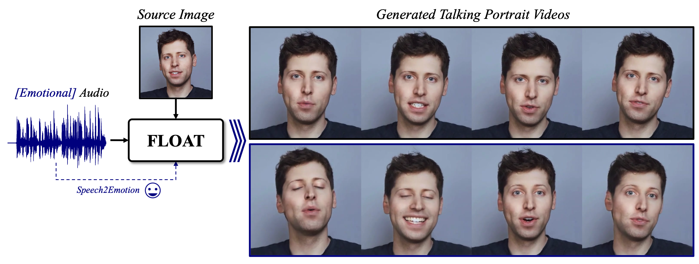

# FLOAT Fast

**A high-performance serving and inference stack for FLOAT — audio-driven talking-portrait generation (ICCV 2025).**

> **Attribution — please read.** FLOAT Fast is a community engineering project built on top of the official **FLOAT** research implementation by [Taekyung Ki](https://taekyungki.github.io), [Dongchan Min](https://kevinmin95.github.io), and [Gyeongsu Chae](https://www.aistudios.com/ko) (DeepBrain AI), presented at **ICCV 2025**. The model architecture, trained checkpoints, method, and original inference code are entirely their work, released under a [Creative Commons Attribution-NonCommercial-NoDerivatives 4.0](https://creativecommons.org/licenses/by-nc-nd/4.0/) license. This repository adds a serving/inference layer around it and **inherits the same non-commercial license**. If you use it, please cite the original paper — see [Citation](#citation).
>
> Upstream project: [deepbrainai-research/float](https://github.com/deepbrainai-research/float) · Project page: https://deepbrainai-research.github.io/float/

---

## What this repository adds

FLOAT Fast wraps the FLOAT generator in production-friendly interfaces and performance work:

- **FastAPI server** — hardware-accelerated inference with **NVENC** video encoding, HTTP **byte-range streaming**, and **WebRTC** signaling for real-time playback.
- **React + Vite "Studio" frontend** — a browser UI for driving generation against the API.
- **Gradio apps** — a batch UI (`gradio_interface.py`) and a live microphone streaming UI (`float_live_app.py`).
- **Batched latent decoding + VRAM auto-sizing** — decodes frames in micro-batches sized to the free GPU memory. See [`docs/BATCH_DECODING.md`](docs/BATCH_DECODING.md).
- **Asynchronous streaming pipeline** — a multi-threaded producer/consumer over multiple CUDA streams and GPUs, overlapping encode, transfer, and disk I/O. See [`docs/STREAMING_PIPELINE.md`](docs/STREAMING_PIPELINE.md).
- **ONNX / TensorRT acceleration** — per-module ONNX export with parity verification and benchmarking, plus a TensorRT (FP16) execution provider chain. See [ONNX & TensorRT](#onnx--tensorrt).

---

## Getting started

### Requirements

- Linux with an **NVIDIA GPU** (upstream tested on A100 and V100).
- **Python 3.10** (from `.python-version`), managed by [uv](https://docs.astral.sh/uv/getting-started/installation/).
- `ffmpeg`, `git`, `wget`, `curl`.
- **Node 20.19+ / 22.12+** for the React frontend.

> The upstream `generate.py` CLI still works, but this fork drives inference through the FastAPI server / Gradio apps.

### Setup

```bash
git clone https://github.com/mohamed-em2m/float-fast.git
cd float-fast
./scripts/setup.sh          # apt deps + uv + uv sync + checkpoints + ONNX toolchain
```

Or manually:

```bash
uv sync --frozen            # Python from .python-version, CUDA torch pins from pyproject.toml
./scripts/download_checkpoints.sh
```

### Preparing checkpoints

Download automatically:

```bash
./scripts/download_checkpoints.sh
```

…or manually from this [Google Drive](https://drive.google.com/file/d/1rvWuM12cyvNvBQNCLmG4Fr2L1rpjQBF0/view?usp=sharing). The checkpoints should be organized as:

```text
./checkpoints
|-- float.pth                                       # main model
|-- wav2vec2-base-960h/                             # audio encoder
|   |-- .gitattributes
|   |-- config.json
|   |-- feature_extractor_config.json
|   |-- model.safetensors
|   |-- preprocessor_config.json
|   |-- pytorch_model.bin
|   |-- README.md
|   |-- special_tokens_map.json
|   |-- tf_model.h5
|   |-- tokenizer_config.json
|   '-- vocab.json
'-- wav2vec-english-speech-emotion-recognition/     # emotion encoder
    |-- .gitattributes
    |-- config.json
    |-- preprocessor_config.json
    |-- pytorch_model.bin
    |-- README.md
    '-- training_args.bin
```

The Wav2Vec2-based models are [wav2vec2-base-960h](https://huggingface.co/facebook/wav2vec2-base-960h) and [wav2vec-english-speech-emotion-recognition](https://huggingface.co/r-f/wav2vec-english-speech-emotion-recognition).

### Running

| Goal | Command | Default URL |
|---|---|---|
| Backend + frontend together | `./scripts/run_all.sh` | API `:8000`, Studio `:3000` |
| FastAPI / WebRTC server only | `./scripts/run_api.sh` | `:8000` |
| React Studio only | `./scripts/run_frontend.sh` | `:3000` |
| Gradio batch app | `./scripts/run_gradio.sh` | `:7860` |
| Gradio live (mic) app | `./scripts/run_live.sh` | `:7860` |

Environment overrides: `PORT`, `FRONTEND_PORT`, `VITE_API_URL`, `CORS_ORIGINS`, `NGPUS` (number of GPUs used for decoding).

---

## API reference

| Method | Endpoint | Description |
|---|---|---|
| `GET` | `/` | Service health status and links |
| `POST` | `/generate` | Generate a talking-portrait video from audio + image |
| `GET` | `/download/{request_id}` | Download the generated MP4 |
| `GET` | `/stream/{request_id}` | Stream the MP4 with HTTP `Range` support |
| `GET` | `/health` | System health, model status, FPS statistics |
| `GET` | `/gpu` | GPU VRAM allocated / reserved (GB) |
| `POST` | `/gpu/clear` | Clear CUDA cache and run garbage collection |
| `POST` | `/offer` | WebRTC SDP negotiation for real-time playback |

### Example `/generate` request

```json
{
  "audio_base64": "<base64-pcm-or-wav>",
  "audio_format": "pcm",
  "sample_rate": 16000,
  "channels": 1,
  "sample_width": 2,
  "image_base64": null,
  "emotion": "S2E",
  "nfe": 10,
  "seed": 25,
  "a_cfg_scale": 2.0,
  "r_cfg_scale": 1.0,
  "e_cfg_scale": 1.0,
  "no_crop": false,
  "compress": true,
  "quality": "balanced"
}
```

---

## ONNX & TensorRT

Inference can be accelerated by exporting the six FLOAT submodules to ONNX and running them through a **TensorRT (FP16) → CUDA → CPU** execution-provider chain, falling back to PyTorch wherever a module is not exported or fails.

```bash
./scripts/convert_to_onnx.sh
```

For each unit — emotion (S2E), FMT step, direction, Wav2Vec2 audio encoder, frame decoder, and reference encoder — the script:

1. exports the module with `torch.export` → ONNX,
2. runs a **parity check** against the PyTorch reference,
3. **benchmarks** warmed latency (PyTorch vs ONNX Runtime), and
4. reports the speedup — a unit is only worth keeping as ONNX when `speedup >= 1`.

TensorRT is used by default when available (FP16 with an on-disk engine cache), otherwise the CUDA execution provider is used, otherwise CPU. Override via `ORT_ARGS`:

```bash
ORT_ARGS="--no-trt" ./scripts/convert_to_onnx.sh        # force the CUDA EP
ORT_ARGS="--trt-fp32" ./scripts/convert_to_onnx.sh      # strict parity (no FP16)
ORT_ARGS="--trt-max-batch 16" ./scripts/convert_to_onnx.sh
```

ONNX Runtime backends are wired into the inference runtime with automatic fallback to PyTorch, so partial acceleration is always safe.

---

## Repository layout

```text
float-fast/
├── pyproject.toml                  # metadata, deps, uv indexes
├── uv.lock                         # pinned lockfile
├── Dockerfile                      # container build (CUDA base)
├── config/api.json                 # endpoint / public URL config
├── scripts/                        # setup, run, and ONNX-conversion scripts
├── checkpoints/                    # model weights
├── docs/                           # BATCH_DECODING.md, STREAMING_PIPELINE.md
├── frontend/                       # React + Vite Studio
└── fast_float/                     # main Python package
    ├── main.py                     # FastAPI entrypoint
    ├── core/                       # inference pipeline & shared state
    ├── routers/                    # generation / health / webrtc endpoints
    ├── schemas/                    # Pydantic v2 models
    ├── utils/                      # GPU, media, logging, video optimizer
    ├── models/float/               # FLOAT generator, FMT, style decoder, encoders
    ├── interfaces/                 # Gradio batch + live apps
    └── onnx/                       # ONNX export, parity, and runtime backends
```

See [`AGENT.md`](AGENT.md) for a deeper architecture guide.

---

## License

This work is licensed under a [Creative Commons Attribution-NonCommercial-NoDerivatives 4.0 International License](https://creativecommons.org/licenses/by-nc-nd/4.0/), inherited from the upstream FLOAT release. **You may not use this work for commercial purposes and may use it only for research purposes.** For any commercial inquiries or collaboration opportunities, please contact daniel@deepbrain.io.

## Development note (upstream)

This repository builds on a research demonstration implementation provided as a one-time code drop. For research-related inquiries about the original method, please contact the first author [Taekyung Ki](https://github.com/TaekyungKi). The original work was done during the first author's South Korean Alternative Military Service at DeepBrain AI. Training code is not released.

---

# About FLOAT (upstream)

The remainder of this document describes the original FLOAT method, results, and credits.



**FLOAT: Generative Motion Latent Flow Matching for Audio-driven Talking Portrait**<br>
[Taekyung Ki](https://taekyungki.github.io), [Dongchan Min](https://kevinmin95.github.io), [Gyeongsu Chae](https://www.aistudios.com/ko)

Project Page: https://deepbrainai-research.github.io/float/

**Abstract**: *With the rapid advancement of diffusion-based generative models, portrait image animation has achieved remarkable results. However, it still faces challenges in temporally consistent video generation and fast sampling due to its iterative sampling nature. This paper presents FLOAT, an audio-driven talking portrait video generation method based on flow matching generative model. Instead of a pixel-based latent space, we take advantage of a learned orthogonal motion latent space, enabling efficient generation and editing of temporally consistent motion. To achieve this, we introduce a transformer-based vector field predictor with an effective frame-wise conditioning mechanism. Additionally, our method supports speech-driven emotion enhancement, enabling a natural incorporation of expressive motions. Extensive experiments demonstrate that our method outperforms state-of-the-art audio-driven talking portrait methods in terms of visual quality, motion fidelity, and efficiency.*

**TL;DR: FLOAT is a flow matching based audio-driven talking portrait video generation method, which can enhance the speech-driven emotional motion.**

## Generation results

| Result 1 | Result 2 |
|---------------|---------|
| <video src="https://github.com/user-attachments/assets/8c00274d-795d-4ee9-870f-84a859f3e23f"> </video> | <video src="https://github.com/user-attachments/assets/c6e142b3-519b-4cda-b26d-e088414b478d"> </video> |

| Result 3 | Result 4 |
|--------|-----------|
| <video src="https://github.com/user-attachments/assets/7b201a5f-a293-46cd-974f-0612062d8d94"> </video> |  <video src="https://github.com/user-attachments/assets/dd4b74dd-40b4-4864-b87d-7cbf4f0d66da"> </video> |

<br>
The method runs faster than current diffusion-based methods with fewer sampling steps and lower memory cost. For more details, please refer to the paper.
<div align='center'>
    <image width= 80% src="./assets/fps.png"> </image>
</div>

## Updates

- [2025.06.26] FLOAT is accepted to **[ICCV 2025](https://iccv.thecvf.com)**
- [2025.02.17] The inference code and checkpoints are released under a **[Non-commercial License](https://creativecommons.org/licenses/by-nc-nd/4.0/)**
- [2024.12.03] Selected as a [HuggingFace Daily Papers](https://huggingface.co/papers?date=2024-12-03) on December 3, 2024
- [2024.12.02] The paper is publicly available on [ArXiv](https://arxiv.org/abs/2412.01064)

## Original usage (from upstream)

### Generating talking-portrait video from a single image and audio

**Pre-processing** — for better quality, please note:

- FLOAT is trained on frontal head-pose distributions. Non-frontal images may lead to suboptimal results.
- The inference code includes an automatic face-cropping function, which may involve black **padding** regions. You can manually disable cropping, though it may lead to suboptimal performance.
- If your audio contains heavy background music, use [ClearVoice](https://github.com/modelscope/ClearerVoice-Studio) to extract the vocals first.

**1. Emotion from audio** — generate with an emotion inferred from the audio (omit `--emo`). Adjust intensity with `--e_cfg_scale` (default 1; try 5–10 for more intensity).

```bash
CUDA_VISIBLE_DEVICES=0 python generate.py \
    --ref_path path/to/reference/image \
    --aud_path path/to/audio \
    --seed 15 \
    --a_cfg_scale 2 \
    --e_cfg_scale 1 \
    --ckpt_path ./checkpoints/float.pth \
    --no_crop                    # [optional] skip cropping
```

**2. Redirecting emotion** — specify `--emo` with one of seven emotions: `['angry', 'disgust', 'fear', 'happy', 'neutral', 'sad', 'surprise']`.

```bash
CUDA_VISIBLE_DEVICES=0 python generate.py \
    --ref_path path/to/reference/image \
    --aud_path path/to/audio \
    --emo 'happy' \
    --seed 15 \
    --a_cfg_scale 2 \
    --e_cfg_scale 1 \
    --ckpt_path ./checkpoints/float.pth \
    --no_crop                    # [optional] skip cropping
```

<video src="https://github.com/user-attachments/assets/fb3826cd-231b-46f2-809b-11adebe9a1cf"> </video>

**3. Running example and results**

```bash
CUDA_VISIBLE_DEVICES=0 python generate.py \
    --ref_path assets/sam_altman.webp \
    --aud_path assets/aud-sample-vs-1.wav \
    --seed 15 \
    --a_cfg_scale 2 \
    --e_cfg_scale 1 \
    --ckpt_path ./checkpoints/float.pth
```

| Before crop | After crop | Result |
|---------------|---------|--------|
|  |  | <video src='https://github.com/user-attachments/assets/3353e4e0-00f5-429b-bc66-5db9a72186b8'> </video> |

## Citation

If you use FLOAT, please cite the original authors:

```bibtex
@inproceedings{ki2025float,
  title={Float: Generative motion latent flow matching for audio-driven talking portrait},
  author={Ki, Taekyung and Min, Dongchan and Chae, Gyeongsu},
  booktitle={Proceedings of the IEEE/CVF International Conference on Computer Vision},
  pages={14699--14710},
  year={2025}
}
```

## Related works

- [StyleLipSync: Style-based Personalized Lip-sync Video Generation](https://arxiv.org/abs/2305.00521)<br>
- [StyleTalker: One-shot Style-based Audio-driven Talking Head Video Generation](https://arxiv.org/abs/2208.10922)<br>
- [Export3D: Learning to Generate Conditional Tri-plane for 3D-aware Expression Controllable Portrait Animation](https://arxiv.org/abs/2404.00636)<br>
- [Latent Image Animator: Learning to Animate Images via Latent Space Navigation](https://arxiv.org/abs/2203.09043)<br>

## Acknowledgements

The source images and audio are collected from the internet and other baselines, such as LIA, SadTalker, EMO, VASA-1, Hallo, LivePortrait, Loopy, and others. We appreciate their valuable contributions to this field. We employ the Wav2Vec2.0-based speech emotion recognizer by [Rob Field](https://huggingface.co/r-f/wav2vec-english-speech-emotion-recognition). We appreciate this good work.
