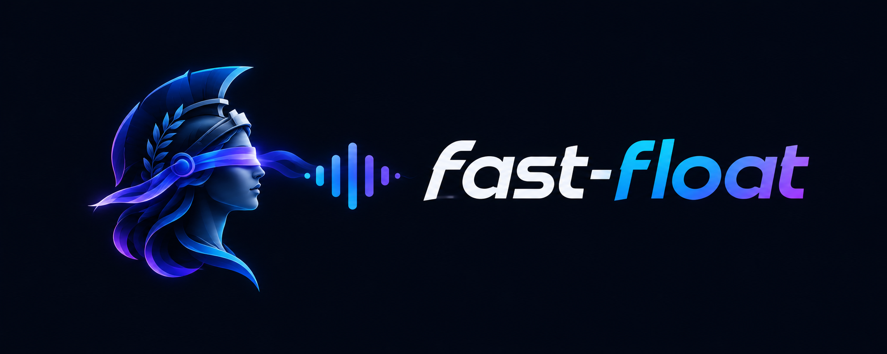
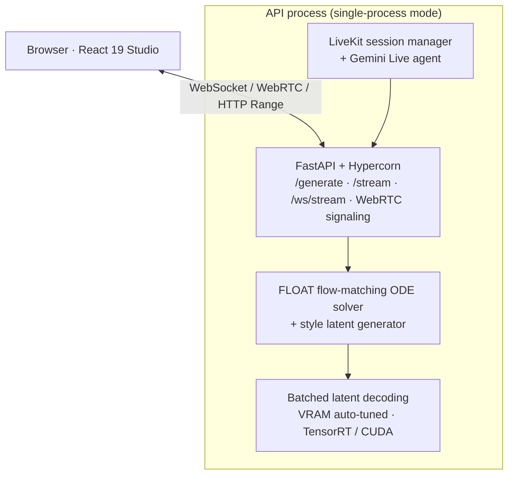

<div align="center">



# FLOAT Fast

**Real-time, GPU-accelerated serving stack for audio-driven talking portraits.**

Built on [FLOAT](https://github.com/deepbrainai-research/float) (ICCV 2025) · Stream video while it is still being generated.

[](https://github.com/mohamed-em2m/float-fast/actions)
[](https://github.com/mohamed-em2m/float-fast/releases)
[](LICENSE)
[](pyproject.toml)
[](https://pytorch.org/)
[](https://fastapi.tiangolo.com/)
[](frontend/)

[Quick Start](#quick-start) · [Documentation](docs/USAGE.md) · [API](#api) · [Report a Bug](https://github.com/mohamed-em2m/float-fast/issues) · [Request a Feature](https://github.com/mohamed-em2m/float-fast/issues)
 . [Try it in colab](https://colab.research.google.com/drive/1iMm8X7O63AAA6kByJ-4qgGA37fwNu2_Z?usp=sharing)

</div>

<!-- TODO: add a demo GIF or screenshot of the Studio here -->
<!-- <p align="center"></p> -->

---

## Overview

Talking-head models such as FLOAT produce impressive results, but they are heavy and are usually run as offline batch jobs. **FLOAT Fast** turns FLOAT into an interactive service:

- **Single-process serving** – the API server owns the GPU and runs inference in its thread pool, so one command starts everything.
- **Streaming first** – frames are pushed over WebSocket, WebRTC, or LiveKit while inference is still running, before the MP4 is finished.
- **Hardware acceleration** – micro-batched latent decoding, NVENC/QSV/AMF encoding, and per-component PyTorch / `torch.compile` / ONNX / TensorRT backends.
- **Conversational avatar** – speech-to-speech interaction through Gemini Live and LiveKit Agents, with live lip-sync.
- **Studio UI** – a React 19 + Vite interface for both batch generation and live audio.

> [!CAUTION]
> **Dual-process (ZeroMQ + shared memory) mode is currently disabled.** It has known bugs, so every command in this README runs in **single-process** mode. `scripts/run_all.sh` already exports `FLOAT_IPC_ENABLED=false`; for any other launcher do the same (see [Running the System](#running-the-system)).
> [!IMPORTANT]
> This project builds on the upstream [FLOAT repository](https://github.com/deepbrainai-research/float). Review its [license](https://github.com/deepbrainai-research/float/blob/main/LICENSE) before using the model weights or architecture, especially for commercial use.

## Table of Contents

- [Features](#features)
- [Architecture](#architecture)
- [Tech Stack](#tech-stack)
- [Quick Start](#quick-start)
- [Installation](#installation)
- [Secrets & Configuration](#secrets--configuration)
- [Running the System](#running-the-system)
- [API](#api)
- [Hardware Acceleration (ONNX / TensorRT)](#hardware-acceleration-onnx--tensorrt)
- [Remote & Colab Usage](#remote--colab-usage)
- [Project Structure](#project-structure)
- [Testing](#testing)
- [Troubleshooting](#troubleshooting)
- [Roadmap](#roadmap)
- [Contributing](#contributing)
- [License](#license)
- [Citation & Acknowledgments](#citation--acknowledgments)
- [Contact](#contact)

---

## Features

| | Feature | Description |
|---|---|---|
| ⚡ | **Single-process serving** | One process owns the GPU and serves HTTP/WebSocket/WebRTC — no IPC layer required. |
| 🎞️ | **Fast generation** | Auto-tuned batched latent decoding with NVENC / QSV / AMF encoding. |
| 📡 | **Live transports** | WebSocket, WebRTC, and LiveKit SFU streaming straight off the decoder. |
| 🗣️ | **Voice avatar** | Real-time speech-to-speech with Gemini Live and LiveKit Agents (`fast_float/livekit/gemini/`). |
| 🧩 | **Per-component backends** | Run each model unit on Eager, `torch.compile`, or ONNX/TensorRT, with automated parity checks. |
| 🖥️ | **Unified Studio** | One React 19 interface for batch generation and interactive live audio. |
| 🛠️ | **One-command setup** | `scripts/setup.sh` bootstraps everything; each launcher starts what it needs. |
| 🧪 | **Dual-process IPC** *(experimental, disabled)* | Optional ZeroMQ + shared-memory split. Currently not supported — see the notice above. |

## Architecture



> A separate GPU worker linked over ZeroMQ (`:5555`/`:5556`) and a shared-memory
> frame ring exists in the tree but is disabled until its bugs are fixed.

## Tech Stack

| Layer | Technology |
|---|---|
| Language | Python 3.10, JavaScript (ESNext / JSX) |
| Serving | FastAPI, Hypercorn, Uvicorn |
| Deep learning | PyTorch 2.7.1 (CUDA 12.6), ONNX Runtime GPU 1.23, TensorRT 10.9 |
| Real-time media | LiveKit SFU & Agents, aiortc (WebRTC), PyAV |
| Frontend | React 19, Vite 8, Lucide Icons |
| Tooling | `uv`, `pnpm`, Ruff, pytest, pre-commit |

---

## Quick Start

```bash
git clone https://github.com/mohamed-em2m/float-fast.git
cd float-fast

./scripts/setup.sh        # one-time: dependencies, ONNX/TensorRT, checkpoints
./scripts/run_all.sh      # single-process API + Studio (no ZeroMQ)
```

Then open:

| Service | URL |
|---|---|
| Studio | <http://localhost:3000> |
| API + Swagger UI | <http://localhost:8000/docs> |

The first boot warms up for roughly 1–5 minutes (weights, ONNX/TensorRT sessions, decode auto-tuning). Results are cached in `~/.cache/fast_float/`.

`Ctrl+C` stops both servers. To use different ports: `PORT=9000 FRONTEND_PORT=3100 ./scripts/run_all.sh`.

## Installation

### Prerequisites

| Requirement | Details |
|---|---|
| OS | Linux recommended (NVENC, TensorRT). Windows is supported with limitations. |
| GPU | NVIDIA GPU with a CUDA 12.6-compatible driver |
| Python | 3.10, managed by [`uv`](https://docs.astral.sh/uv/) |
| Node.js | 20.19+ or 22.12+ with [`pnpm`](https://pnpm.io/) |
| System tools | `ffmpeg`, `git`, `curl` |

### Option A — Automated (recommended)

```bash
chmod +x scripts/setup.sh
./scripts/setup.sh
```

The script installs system packages, `uv` and Python 3.10, Node 22 and `pnpm`, frontend dependencies, the pinned CUDA 12.6 PyTorch stack (`uv sync --inexact`), ONNX Runtime GPU and TensorRT, optionally starts a local LiveKit SFU via Docker Compose, and downloads the checkpoints (`float.pth`, Wav2Vec2, speech-emotion model).

### Option B — Manual

```bash
git clone https://github.com/mohamed-em2m/float-fast.git
cd float-fast

uv sync --frozen                                   # Python environment
chmod +x scripts/download_checkpoints.sh
./scripts/download_checkpoints.sh                  # model weights

cd frontend && pnpm install && cd ..              # Studio dependencies
```

> [!NOTE]
> On a CUDA machine, prefer `./scripts/setup.sh` over a plain `uv sync`. Setup layers `onnxruntime-gpu` and TensorRT 10.9 on top of the lockfile; a plain `uv sync` / `uv run` reverts to the CPU `onnxruntime`, and the server boots with only `AzureExecutionProvider` and `CPUExecutionProvider`. All launchers therefore use `uv run --frozen --no-sync`.

### Docker

A multi-stage CUDA 12.6 `Dockerfile` is included at the repository root.

---

## Secrets & Configuration

Settings are resolved in this order (highest priority first):

1. Environment variables
2. `fast_float/config/secerts.toml` — git-ignored, machine-local secrets *(the filename's spelling is intentional)*
3. `fast_float/config/settings.toml` — committed, non-secret defaults
4. `.env` at the repo root — optional fallback (see `.env.example`)

```toml
# fast_float/config/secerts.toml  (never commit this file)
[livekit]
url        = "wss://<your-project>.livekit.cloud"  # or "ws://127.0.0.1:7880" for local Docker
api_key    = "<LIVEKIT_API_KEY>"
api_secret = "<LIVEKIT_API_SECRET>"

[gemini]
api_key = "<GOOGLE_API_KEY>"   # GOOGLE_API_KEY / GEMINI_API_KEY env vars also work
```

The same file is read by the API and the Gemini worker, so a single key serves both. If you have no LiveKit project and no local Docker, leave `[livekit].url` empty: live transports fall back to WebRTC, then WebSocket/MP4.

### Environment variables

| Variable | Description | Default |
|---|---|---|
| `PORT` | API server port | `8000` |
| `FRONTEND_PORT` | Studio dev-server port | `3000` |
| `FLOAT_IPC_ENABLED` | Enable the experimental ZeroMQ/SHM worker split. **Keep `false`** while dual-process is disabled. | `true` in `settings.toml` (`false` when set by `run_all.sh` / `--no-dual-process`) |
| `WARMUP_WAIT_TIMEOUT_S` | Max seconds `/generate` waits for warmup | `600` |
| `LIVEKIT_URL` | LiveKit SFU WebSocket endpoint | set in `settings.toml` |
| `LIVEKIT_API_KEY` | LiveKit API key | `devkey` (local dev only) |
| `LIVEKIT_API_SECRET` | LiveKit API secret | `secret` (local dev only) |
| `GEMINI_API_KEY` | Gemini key for the voice agent | — |

> [!WARNING]
> `devkey` / `secret` are development defaults for a local LiveKit server. Always set your own credentials before exposing the service publicly.

---

## Running the System

> [!CAUTION]
> **All supported modes below run single-process.** The zero-copy ZeroMQ worker
> split (`scripts/run_dual_process.sh`, `fast-float serve` without
> `--no-dual-process`) is disabled until its bugs are fixed.

### Recommended — API + Studio

```bash
./scripts/run_all.sh
```

Starts the FastAPI backend (`:8000`) and the Vite Studio (`:3000`) in one
process tree, with `FLOAT_IPC_ENABLED=false` already exported. Logs stream to
`logs/combined.log`; `Ctrl+C` stops everything.

### API only

```bash
FLOAT_IPC_ENABLED=false ./scripts/run_api.sh
```

Single process: the API loads the model itself. The `FLOAT_IPC_ENABLED=false`
prefix is required because `settings.toml` still ships `[ipc] enabled = true`;
without it the server looks for a worker that is not running.

### Gradio interfaces

```bash
FLOAT_IPC_ENABLED=false ./scripts/run_gradio.sh   # batch: upload image + audio
FLOAT_IPC_ENABLED=false ./scripts/run_live.sh     # live microphone streaming
```

### Studio only

Use this when the API runs separately (e.g. behind a tunnel):

```bash
./scripts/run_frontend.sh        # Vite dev server on :3000
```

### `fast-float` CLI

```bash
# API + Studio, single process (recommended)
uv run --frozen --no-sync fast-float serve --no-dual-process --frontend

# API only
uv run --frozen --no-sync fast-float serve --no-dual-process

# Custom ports
uv run --frozen --no-sync fast-float serve --no-dual-process --frontend \
    --port 9000 --frontend-port 3100

# Studio only / Gemini Live worker
uv run --frozen --no-sync fast-float ui --port 3000
uv run --frozen --no-sync fast-float agent
```

`--no-dual-process` is what sets `FLOAT_IPC_ENABLED=false`; do not run the CLI
without it for now.

### Verify the boot

```bash
curl http://localhost:8000/health
# {"model_loaded": true, ..., "warming_up": false}  → ready
```

---

## API

Interactive docs are served at `http://localhost:8000/docs`.

### `POST /generate`

```bash
curl -X POST http://localhost:8000/generate \
  -H "Content-Type: application/json" \
  -d '{
    "audio_base64": "<BASE64_PCM_OR_WAV>",
    "image_base64": "<BASE64_IMAGE>",
    "emotion": "S2E",
    "nfe": 10,
    "quality": "balanced",
    "live": true
  }'
```

| Field | Description |
|---|---|
| `audio_base64` | Base64-encoded PCM or WAV speech |
| `image_base64` | Base64-encoded reference portrait |
| `emotion` | Emotion mode (e.g. `S2E`, speech-to-emotion) |
| `nfe` | Number of function evaluations for the ODE solver |
| `quality` | Quality preset (e.g. `balanced`) |
| `live` | Enable live frame streaming while generating |

### Python client

```python
import base64
import requests


def b64(path: str) -> str:
    with open(path, "rb") as f:
        return base64.b64encode(f.read()).decode()


response = requests.post(
    "http://localhost:8000/generate",
    json={
        "image_base64": b64("portrait.jpg"),
        "audio_base64": b64("voice.wav"),
        "emotion": "S2E",
        "nfe": 10,
        "quality": "balanced",
    },
    timeout=600,
)
response.raise_for_status()
result = response.json()

print("Generation time:", result["performance"]["total_time"], "s")
print("Stream URL:     ", result["stream_url"])
print("Download URL:   ", result["download_url"])
```

---

## Hardware Acceleration (ONNX / TensorRT)

Convert individual units (FMT, Wav2Vec2, Style Decoder) to ONNX/TensorRT:

```bash
./scripts/convert_to_onnx.sh             # convert all units and run the backend selector
./scripts/convert_fmt_to_onnx.sh         # FMT only
./scripts/convert_wav2vec_to_onnx.sh     # Wav2Vec2 only
```

Choose a backend per component in `config/backends.yaml`:

| Backend | Behavior |
|---|---|
| `eager` | Standard PyTorch |
| `compile` | `torch.compile` |
| `onnx` | ONNX Runtime with TensorRT → CUDA → CPU fallback |

## Remote & Colab Usage

`examples/fast_float.ipynb` is the tested end-to-end path for a fresh GPU machine (verified on Colab T4). On a remote box with no public URL, expose the **Studio** (port 3000, not the API) over HTTPS; browsers require a secure context for microphone access.

```bash
# terminal 1 — single-process API + Studio
./scripts/run_all.sh

# terminal 2
./scripts/run_tunnel.sh          # prints https://<id>.trycloudflare.com
./scripts/run_tunnel.sh url      # re-print the URL
./scripts/run_tunnel.sh stop     # stop the tunnel
```

If `cloudflared` is missing:

```bash
curl -fsSL https://github.com/cloudflare/cloudflared/releases/latest/download/cloudflared-linux-amd64.deb -o /tmp/cloudflared.deb
sudo dpkg -i /tmp/cloudflared.deb
```

---

## Project Structure

```text
float-fast/
├── assets/                  # Logo and sample media
├── config/                  # api.json, backends.yaml, logging.json
├── docs/                    # Guides and specifications
├── fast_float/              # Python package
│   ├── cli.py               # `fast-float` supervisor CLI
│   ├── core/                # Generation orchestrator and pipeline
│   ├── ipc/                 # ZeroMQ client/server, shared-memory ring (disabled)
│   ├── livekit/             # LiveKit integration, Gemini Live agent
│   ├── models/              # FLOAT, FMT, Wav2Vec2 architectures
│   ├── onnx/                # ONNX export, TensorRT runtimes, backend dispatch
│   ├── routers/             # generation, livekit, webrtc, health
│   ├── streaming/           # Frame dispatcher, tap queues, live transports
│   ├── utils/               # GPU tracking, video optimizers, logging
│   ├── workers/             # Dedicated GPU worker (disabled)
│   └── main.py              # FastAPI entrypoint
├── frontend/                # React 19 + Vite Studio
├── scripts/                 # setup, run_*, convert_*, download_checkpoints
├── tests/                   # pytest suites
├── Dockerfile               # Multi-stage CUDA 12.6 image
├── pyproject.toml
└── uv.lock
```

## Testing

```bash
uv run ruff check .
uv run ruff format --check .
uv run pytest tests/
(cd frontend && pnpm test)
uv run pre-commit run --all-files
```

## Troubleshooting

| Symptom | Likely cause and fix |
|---|---|
| Server lists only `AzureExecutionProvider` / `CPUExecutionProvider` | A plain `uv sync` replaced `onnxruntime-gpu`. Re-run `./scripts/setup.sh` and launch with `uv run --frozen --no-sync`. |
| `/generate` hangs right after startup | The model is still warming up. Check `/health` for `"warming_up": false` (timeout: `WARMUP_WAIT_TIMEOUT_S`). |
| Microphone does not work remotely | `getUserMedia` needs HTTPS. Tunnel the Studio on port 3000, not the API. |
| No live LiveKit stream | Leave `[livekit].url` empty to fall back to WebRTC/WebSocket, or verify your keys in `secerts.toml`. |
| `FileNotFoundError: /float_frame_ring`, or live conversation hangs | The API is trying to reach the disabled ZeroMQ worker. Start with `./scripts/run_all.sh`, or export `FLOAT_IPC_ENABLED=false` (`--no-dual-process` for the CLI). |
| `ZMQ` connection/socket errors in the log | Same cause: dual-process mode is disabled. Use a single-process launcher above. |

## Roadmap

- [x] FastAPI server with NVENC hardware acceleration
- [x] Real-time frame taps over WebSocket, WebRTC, and LiveKit
- [x] LiveKit conversational avatar with Gemini Live
- [x] Per-component ONNX / TensorRT backend selector
- [x] React 19 Studio with Studio and Live Audio modes
- [x] One-command setup (`scripts/setup.sh`)
- [ ] Dual-process ZeroMQ + shared-memory GPU isolation *(implemented, disabled pending bug fixes)*
- [ ] Multi-speaker audio separation and diarization
- [ ] Multi-face portrait animation and background stabilization

## Contributing

Contributions are welcome.

1. Fork the repository
2. Create a branch: `git checkout -b feature/amazing-feature`
3. Commit using [Conventional Commits](https://www.conventionalcommits.org/): `git commit -m "feat(scope): add amazing feature"`
4. Push: `git push origin feature/amazing-feature`
5. Open a Pull Request

Before submitting, make sure `uv run ruff check .` and `uv run pre-commit run --all-files` pass.

## License

Released under the [MIT License](LICENSE). The upstream FLOAT checkpoints and research materials are governed by their own [license](https://github.com/deepbrainai-research/float/blob/main/LICENSE).

## Citation & Acknowledgments

This project builds on the work of the FLOAT authors. If you use it in research, please cite the original paper:

```bibtex
@inproceedings{ki2025float,
  title     = {FLOAT: Generative Motion Latent Flow Matching for Audio-driven Talking Portrait},
  author    = {Ki, Taekyung and Min, Dongchan and Chae, Gyeongsu},
  booktitle = {Proceedings of the IEEE/CVF International Conference on Computer Vision (ICCV)},
  year      = {2025}
}
```

Thanks to the teams behind [FLOAT](https://github.com/deepbrainai-research/float), [LiveKit](https://livekit.io/), [FastAPI](https://fastapi.tiangolo.com/), and [PyTorch](https://pytorch.org/).

## Contact

**Mohamed Emam** · [@mohamed-em2m](https://github.com/mohamed-em2m)
Project: <https://github.com/mohamed-em2m/float-fast>
