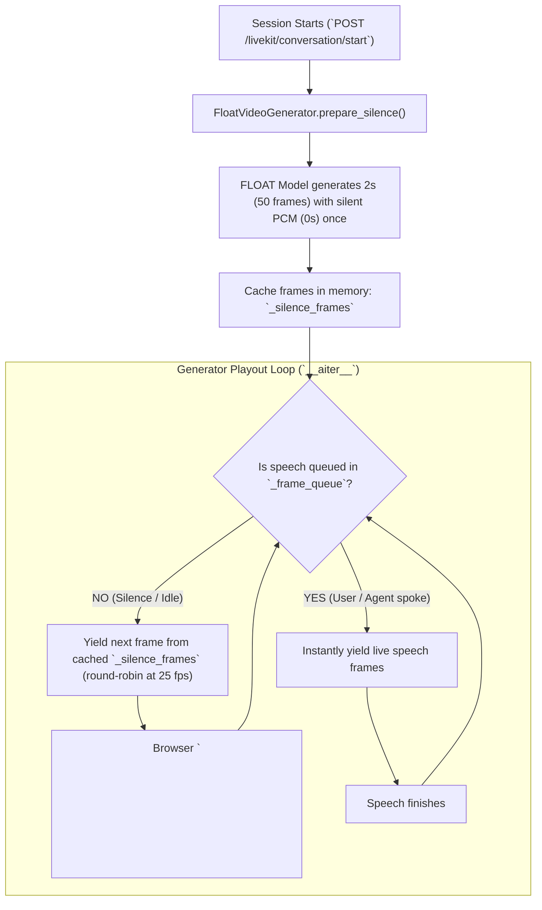

Here is how the silence/idle avatar loop works end-to-end:

---

### The Problem Before

1. When the avatar finished speaking (or before the first response arrived), **no video frames were generated**.
2. LiveKit tracks stopped receiving new frames, so the browser `<video>` element simply **froze on the last rendered frame** (looking frozen/stuck like a crashed stream).
3. Re-generating video constantly for silence in real time would waste GPU cycles and add latency.

---

### The Solution: One-time Generation & Looping

---

### Step-by-Step Breakdown

#### 1. Generated Once at Session Start

When you click **"Go Live"** and the backend starts the session in [`fast_float/livekit/session.py`](file:///c:/Users/emam2/tech_projects/float-fast/fast_float/livekit/session.py):

* `prepare_silence(duration_sec=...)` is called **once** on the active generator — the local GPU generator (`FloatVideoGenerator`) or the IPC generator (`ZmqFloatVideoGenerator`).
* The duration is the `[float].livekit_silence_sec` operator setting (default 2.0 s, range 0.5–30 s).
* The generator runs FLOAT inference conditioning on that many seconds of pure silent audio (`0` PCM samples) with the chosen portrait.
* The output frames (which show natural, subtle breathing/idle head motion without lip movement) and silent audio slices are saved in an in-memory list: `self._silence_frames`.
* Because it's cached in memory, **zero GPU compute** is used during silence thereafter.

In the dual-process (IPC) mode the render happens in the FLOAT worker (Process 1). The worker publishes each frame over ZeroMQ with an `is_last` sentinel at the end; the backend's frame listener is the **single reader** of that socket and routes the replay into the silence bucket while the `prepare_silence` request is in flight, then the backend caches the loop locally.

#### 2. Generator Loop (`__aiter__`)

Inside [`FloatVideoGenerator.__aiter__`](file:///c:/Users/emam2/tech_projects/float-fast/fast_float/livekit/generator.py):

* **When idle (no speech queued):**
  It pulls the next frame from `self._silence_frames` in a round-robin loop (`self._silence_idx % len(frames)`) and yields it to LiveKit's `rtc.AVSynchronizer` at 25 fps (40 ms per frame).
* **When speech arrives (Gemini or TTS replies):**
  The generator detects frames in `_frame_queue`. It immediately steps out of the silence loop and streams the real speech frames in lockstep with the generated audio.
* **When speech ends:**
  As soon as the speech queue empties again, it transitions straight back into looping the cached silence frames.

#### 3. Frontend Experience

* The frontend `<video>` track in [`LiveAudioStudio.jsx`](file:///c:/Users/emam2/tech_projects/float-fast/frontend/src/components/LiveAudioStudio.jsx) receives a **continuous, unbroken 25 fps video stream** via WebRTC from start to finish.
* When the avatar is listening or waiting, it appears naturally alive (idle head motion/breathing) instead of freezing like a still photo.
