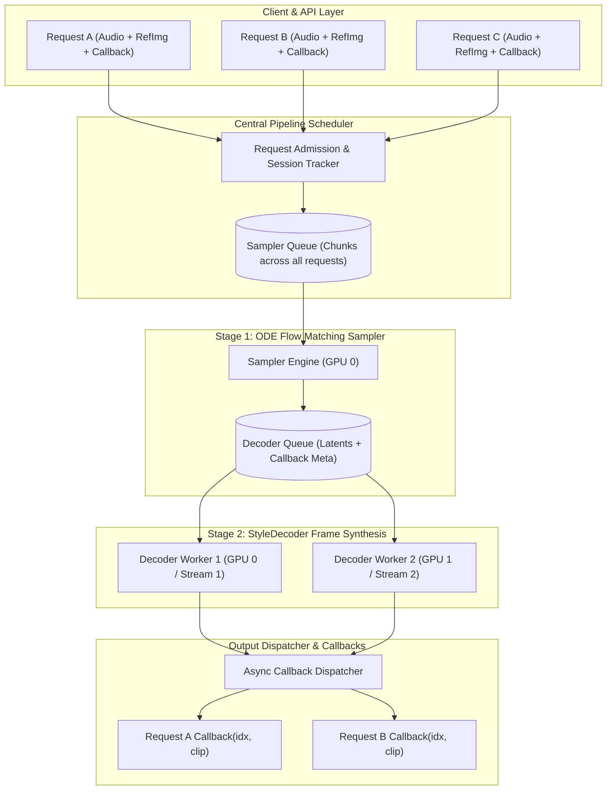

# FLOAT-Fast: Original Cloud Architecture Plan (Gemini Design)

> **Document Type**: Original Architecture Proposal  
> **Source**: Gemini Architecture Blueprint for Cloud & Multi-Stream Scheduling  
> **Inspiration**: [vLLM-Omni](https://github.com/vllm-project/vllm) & [SGLang](https://github.com/sgl-project/sglang) Disaggregated Pipeline Paradigms  
> **Target System**: [FLOAT-Fast (Flow Matching Talking Face Generation)](file:///c:/Users/emam2/tech_projects/float-fast/fast_float/models/float/FLOAT.py)

---

## Executive Summary & Motivation

In standard single-stage Large Language Model (LLM) serving engines, the system primarily coordinates a homogeneous token decoding loop. However, **omni-modality talking head pipelines** (such as FLOAT: Audio Feature Extraction $\rightarrow$ Continuous Flow Matching ODE Latent Sampler $\rightarrow$ Convolutional StyleDecoder Pixel Synthesis) represent **heterogeneous, multi-stage pipelines**.

Under the legacy implementation:
- A single global lock (`async with state.inference_lock`) serializes all requests.
- If Request A generates a 60-second video (~30 chunks), Request B has to wait 15–25 seconds before generating its very first frame (Head-of-Line Blocking).
- The ODE sampler and StyleDecoder run synchronously one after another for the same request, leaving the StyleDecoder idle while the sampler calculates, and leaving the sampler idle while the StyleDecoder renders frames.

This document articulates the **original cloud architecture design** proposed by Gemini, drawing directly from the disaggregated pipeline architecture of **vLLM-Omni** and continuous batching from **SGLang**.

---

## Architectural Principles from vLLM-Omni & SGLang

```
┌─────────────────────────────────────────────────────────────────────────────┐
│                       vLLM-Omni & SGLang Core Tenets                        │
├─────────────────────────────────────────────────────────────────────────────┤
│ 1. Disaggregated Stage Execution: Decouple distinct compute stages          │
│    (Conditioning -> ODE Sampler -> StyleDecoder) into isolated workers.     │
│                                                                             │
│ 2. Fine-Grained Async Chunking (async_chunk): Decompose sequences into      │
│    independent 50-frame/2-second units; stream outputs progressively.        │
│                                                                             │
│ 3. Continuous Multi-Request Round-Robin Scheduling: Fair-share chunk        │
│    interleaving across active requests to eliminate Head-of-Line blocking.  │
│                                                                             │
│ 4. Decoupled Cross-Stage Queueing: Connect stages via asynchronous queues    │
│    with backpressure to maximize GPU tensor core utilization.               │
└─────────────────────────────────────────────────────────────────────────────┘
```

1. **Disaggregated Stage Execution**:
   - **Upstream Stage (Conditioning & Sampler)**: Audio feature extraction ($w_a$) via Wav2Vec2, identity pre-encoding ($x_r$), and DiT/ODE latent flow generation.
   - **Downstream Stage (Neural Renderer / Vocoder / Decoder)**: Frame synthesis via convolutional `StyleDecoder`.
   - Each stage executes within its dedicated worker loop or worker pool, operating on separate CUDA streams or distinct GPUs.

2. **Async Chunking (`async_chunk`)**:
   - Instead of forcing a request to generate its entire sequence before returning, the pipeline produces fine-grained chunks (e.g., 50 frames / 2 seconds at 25 fps).
   - As soon as the upstream sampler completes latent chunk $i$, it pushes the latent chunk into an asynchronous cross-stage queue (`OmniConnector`).
   - The downstream StyleDecoder begins rendering chunk $i$ immediately while the sampler is already generating chunk $i+1$.

3. **Decoupled Request Scheduling & Continuous Fair-Share Batching**:
   - The GPU is never locked exclusively for one request.
   - The orchestrator pulls ready chunks across all concurrent active requests using Round-Robin Fair Share:
     $$\text{Chunk } 0_A \longrightarrow \text{Chunk } 0_B \longrightarrow \text{Chunk } 1_A \longrightarrow \text{Chunk } 1_B \longrightarrow \dots$$
   - **Result**: Time-To-First-Frame (TTFF) drops from ~15s to **< 500ms**, with seamless pipeline overlap.

---

## Cloud Omni Engine Architecture



---

## Key System Components

### 1. Per-Request Clip Callback Protocol

API callers or client services pass a typed callback handler per request:

```python
from typing import Protocol, Union
import numpy as np
import torch

class ClipCallback(Protocol):
    async def __call__(
        self, 
        request_id: str, 
        clip_idx: int, 
        clip: Union[torch.Tensor, np.ndarray],
        is_last: bool,
    ) -> None:
        """Invoked immediately as soon as a chunk finishes decoding.
        
        Args:
            request_id: Unique identifier for the client session/request.
            clip_idx: Monotonically increasing sequence index (0, 1, 2, ...).
            clip: Decoded visual clip. Can be torch.Tensor [T, 3, H, W] (GPU/CPU)
                  or numpy.ndarray [T, H, W, 3] uint8.
            is_last: True if this chunk concludes the video stream.
        """
        ...
```

#### Protocol Advantages:
- **Zero-Copy Flexibility**: Supports direct GPU PyTorch tensors, CPU tensors, or NumPy arrays (ready for OpenCV or WebRTC encoding).
- **Transport Agnostic**: Consumable by WebRTC media tracks, WebSocket byte packets, Server-Sent Events (SSE), or local file muxers without GPU stalls.

---

### 2. Decoupled Multi-Queue Architecture

The monolithic lock (`inference_lock`) is replaced with isolated asynchronous queues:

```
┌────────────────────────────────────────────────────────────────────────┐
│                        Decoupled Stage Queues                          │
└────────────────────────────────────────────────────────────────────────┘

 [Client Request]
        │
        ▼
 ┌──────────────────────────────────────┐
 │  Admission & Audio Conditioning Q    │
 │  - Wav2Vec2 audio feature extraction │
 │  - Identity image embedding (x_r)    │
 │  - Split into ChunkTasks             │
 └──────────────────┬───────────────────┘
                    │
                    ▼
 ┌──────────────────────────────────────┐
 │  SamplerQueue (ODE Flow-Matching)    │
 │  - Batches z_0 across active reqs    │
 │  - Dispatches LatentChunk to DecQ    │
 └──────────────────┬───────────────────┘
                    │
                    ▼
 ┌──────────────────────────────────────┐
 │  DecoderQueue (StyleDecoder)         │
 │  - Parallel workers (multi-stream)   │
 │  - Non-blocking frame rendering      │
 └──────────────────┬───────────────────┘
                    │
                    ▼
 ┌──────────────────────────────────────┐
 │  CallbackDispatcher                  │
 │  - Emits (idx, clip) via Callback    │
 └──────────────────────────────────────┘
```

1. **Admission & Audio Queue**:
   - Executes pre-computation once per request: audio feature sequence $w_a \in \mathbb{R}^{T_a \times D_a}$ and reference portrait features $x_r \in \mathbb{R}^{B \times C \times H \times W}$.
   - Deconstructs the overall request into discrete `ChunkTask` structures:
     $$\text{ChunkTask}(\text{request\_id}, \text{chunk\_idx}, \text{total\_chunks}, \dots)$$

2. **`SamplerQueue` (ODE Latent Generator)**:
   - Dedicated worker pulling pending tasks across all active requests.
   - Capable of batching multiple request chunks into a single forward pass:
     $$z_0 \in \mathbb{R}^{B_{\text{batch}} \times L \times D}$$
   - Emits `LatentChunk(request_id, chunk_idx, latents, callback)` directly into the `DecoderQueue`.

3. **`DecoderQueue` (StyleDecoder Synthesis)**:
   - Worker pool (multi-stream or multi-GPU) pulling independent latent representations.
   - Once a chunk finishes rendering into RGB frames, it dispatches the resulting clip to the **`CallbackDispatcher`** in a non-blocking background task.

---

### 3. Continuous Multi-Request Fair-Share Scheduler

#### The Problem with Monolithic Sequential Processing
In serial inference, requests are served First-Come-First-Served (FCFS):

$$\text{Request A (30 chunks, 60s)} \implies \text{Wait Time for Request B } \approx 20\text{s}$$

#### The Omni Fair-Share Interleaving Solution
The scheduler services requests concurrently using chunk-level round-robin interleaving:

$$\text{Timeline}: \quad [A_0] \longrightarrow [B_0] \longrightarrow [A_1] \longrightarrow [B_1] \longrightarrow [A_2] \longrightarrow \dots$$

```
Sequential:
Req A: |--- A0 ---|--- A1 ---|--- A2 ---| ... |--- A29 ---|
Req B:                                                    |--- B0 ---|--- B1 ---|
(TTFF of Req B = 30 * t_chunk ≈ 20s)

Omni Fair-Share:
Req A: |--- A0 ---|           |--- A1 ---|           |--- A2 ---|
Req B:            |--- B0 ---|           |--- B1 ---|
(TTFF of Req B = 2 * t_chunk ≈ 0.8s)
```

#### Metrics & Benefits:
- **Time-To-First-Frame (TTFF)**: Drops from $>15\text{s}$ down to **$<500\text{ms}$** for all concurrent clients.
- **Hardware Overlap**: While the StyleDecoder is synthesizing RGB frames for Chunk $A_k$, the Flow-Matching ODE Sampler is concurrently computing latents for Chunk $B_k$.

---

## Step-by-Step Implementation Roadmap

| Phase | Milestone | Deliverables & Scope |
| :---: | :--- | :--- |
| **Phase 1** | **Callback Protocol & Sampler/Decoder Decoupling** | • Refactor `FLOAT` to separate `sample_chunk_latent(...)` from `decode_chunk_latent(...)`.<br>• Define the formal `ClipCallback` protocol.<br>• Enable streaming latent generation decoupled from pixel rendering. |
| **Phase 2** | **Asynchronous Pipeline Queues** | • Build `FloatOmniPipeline` with `asyncio.Queue` structures.<br>• Implement `SamplerEngine` loop and `DecoderWorkerPool`.<br>• Provide thread/stream isolation between sampler and decoder. |
| **Phase 3** | **Interleaved Multi-Request Scheduler** | • Deprecate `state.inference_lock`.<br>• Implement round-robin fair-share chunk dispatching across requests.<br>• Add queue backpressure bounds to protect GPU VRAM. |
| **Phase 4** | **FastAPI & Streaming Integration** | • Update HTTP `/generate` and `/api/inference` endpoints.<br>• Support streaming callbacks via WebSockets, SSE, and WebRTC tracks.<br>• Provide transparent fallback to aggregated MP4 collection. |

---

## Summary Comparison

| Dimension | Legacy FLOAT Pipeline | Gemini Omni Cloud Architecture |
| :--- | :--- | :--- |
| **Concurrency** | Coarse-grained global lock (`inference_lock`) | Lock-free multi-request queue scheduling |
| **Scheduling** | Monolithic FCFS (entire video runs to completion) | Fair-share Round-Robin chunk interleaving |
| **TTFF** | 10–30 seconds | **< 500 ms** |
| **Hardware Overlap** | None (Sampler and Decoder run sequentially) | Concurrent (Sampler computes chunk $k+1$ while Decoder renders chunk $k$) |
| **Output Delivery** | Monolithic MP4 file at end of generation | Progressive per-chunk streaming via `ClipCallback` |
| **Scalability** | Single GPU, single request | Multi-stream, multi-worker, multi-GPU cloud scale |
